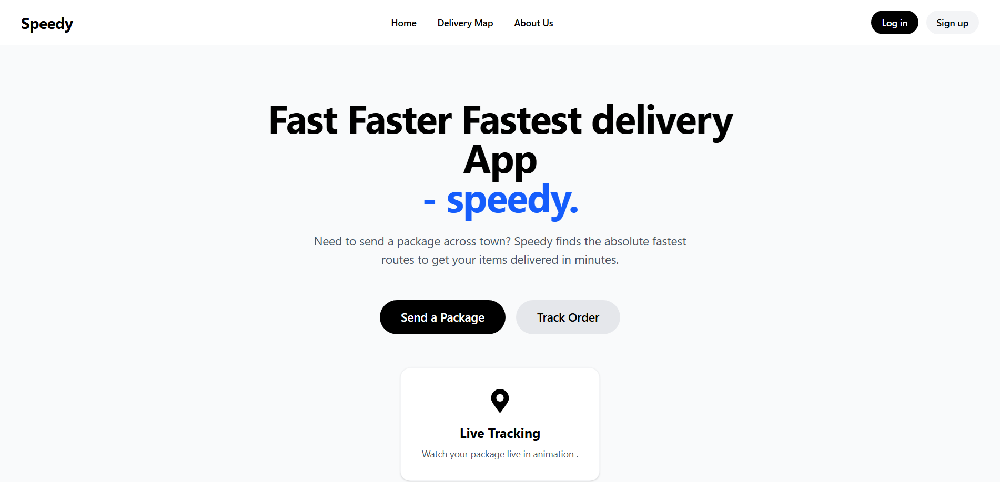
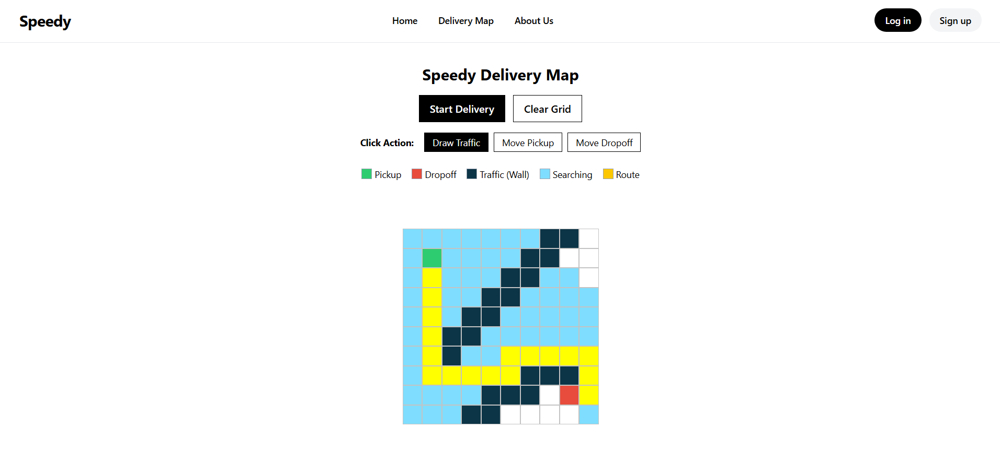

# Speedy -
  the speedest delivery app in the world.

  

I wanted to build the shortest path features you see in Google Maps and uber swiggy etc delivery apps. It looked hard, so I decided to just start with a simple 2D grid and see how things go.



 with the help of Dijkstra algorithm, built the grid UI and added start and end points. And the animation is actually working built a 10x10 visual grid using a 2D array in React state, then setup a green square as my starting point and a red square as my ending point. You can literally watch the squares turn blue as it searches the grid and once it hits the target, the shortest path lights up in yellow

## Features

*   **Interactive Grid:** 10x10 map built with react state
*   **Dynamic Routing:** you can click to move the start and end points on the map
*   **Traffic Simulation (Walls):** click and drag your mouse to draw solid walls that the algorithm has to navigate around
*   **Animations:** squares turn blue when searching and yellow for the final shortest path

## Live Demo
https://speedy-drab.vercel.app/


## How to Run Locally

Want to test it out on your own machine?

1. Clone the repository:
   ```bash
   git clone https://github.com/sooraj44882/speedy.git
   ```

2. Open the folder:
   ```bash
   cd speedy
   ```

3. Install the dependencies:
   ```bash
   npm install
   ```

4. Start the local server:
   ```bash
   npm run dev
   ```

